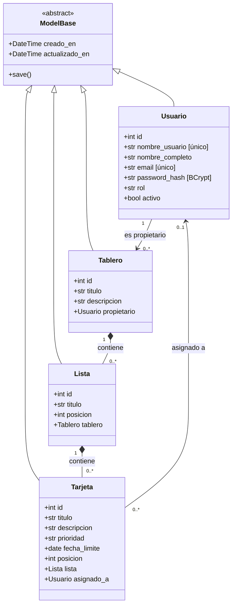
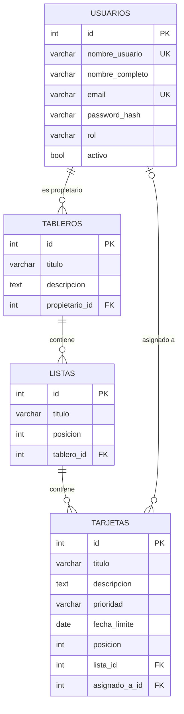
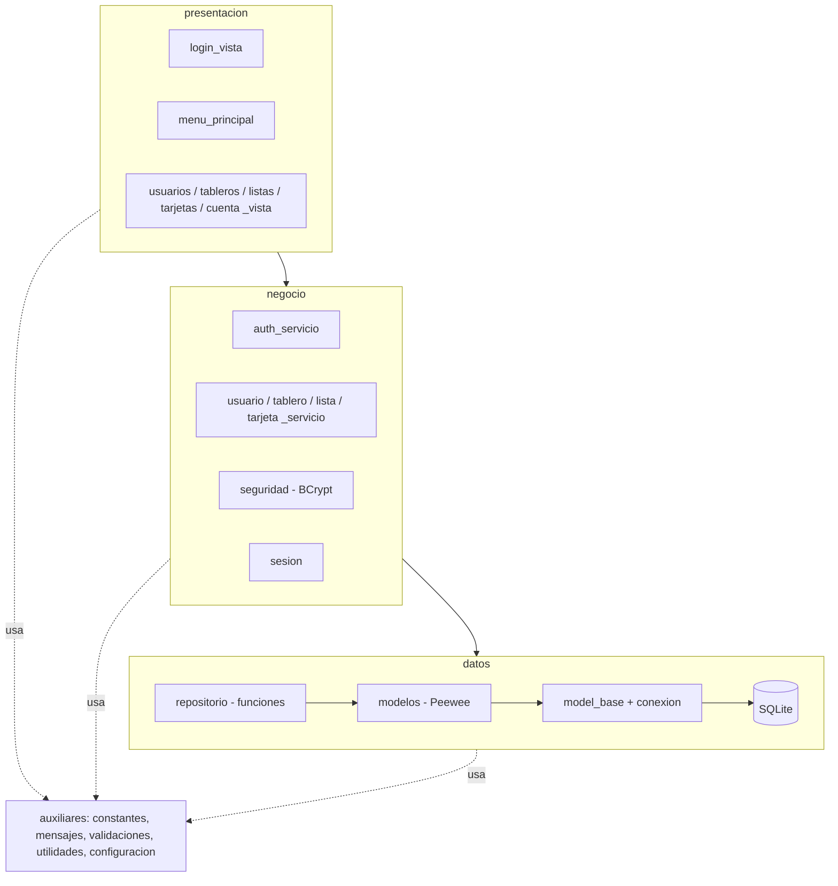
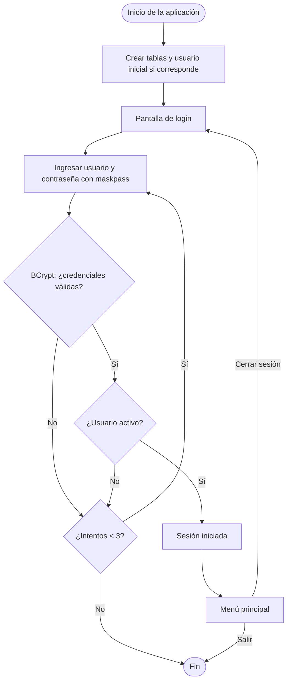

# Diagramas del proyecto

Los diagramas están en formato [Mermaid](https://mermaid.js.org/), que GitHub renderiza automáticamente.

## 1. Diagrama de clases UML (modelos ORM)

## 2. Modelo entidad-relación

## 3. Arquitectura por capas

## 4. Flujo de autenticación

